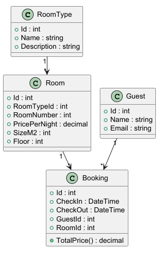

# Hotel Grandioso — Inlämning 1

**Namn:** David Billfeldt

## Så kör du projektet

1. Klona repot
2. Öppna `HotelGrandioso.slnx` i Rider eller Visual Studio
3. Starta programmet (Run / F5)

Via terminalen:

    dotnet run --project HotelGrandioso

Databasen skapas automatiskt första gången programmet körs, så inga extra steg behövs.

## Databas

- Databas: SQLite (filen `hotel.db` skapas i samma mapp som programmet körs från)
- EF Core Code First med migrationer, som ligger i `HotelGrandioso/Migrations/`
- `Program.cs` kör `Database.Migrate()` vid start, som skapar databasen och tabellerna om de saknas
- Seed-data: hotellets 3 rumstyper och 15 rum läggs in automatiskt via `HasData` i `HotelContext`
- Vill du skapa databasen för hand: `dotnet ef database update` i mappen `HotelGrandioso`

## UML-klassdiagram

  

## GDPR

- Id: Nyckel som databasen behöver och säger inget om personen.
- Name: Namn i bokningssyfte.
- Email: Lade till email då det kan vara bra att ha i bokningssyfte och få bekräftelse.
- HairColor: Behövs ej då det saknar syfte för en bokning. (Dataminimering)
- HeightCm: Behövs ej då det saknar syfte för en bokning (om inte gästen är längre än sängarna kanske), (dataminimering)
- Religion: Syfte saknas definitivt och är känsliga personuppgifter enligt GDPR artikel 9.

## Designmönster: Repository

All kod som pratar med databasen ligger i klassen `HotelRepository` i mappen `Services/`. Den har fyra metoder: hämta alla rum, hämta alla bokningar, boka ett rum och avboka en bokning.

Repositoryt har ett interface, `IHotelRepository`, som beskriver *vad* som går att göra. `HotelRepository` beskriver *hur* det görs med EF Core. Konsolmenyn (`UI/ConsoleMenu.cs`) får repositoryt via sin konstruktor och känner bara till interfacet.

Jag valde Repository för att:
- menyn ska bara sköta in- och utmatning och inte behöva veta något om databasen
- all databaskod finns på ett ställe, så den är lätt att hitta och ändra
- om databasen byts ut (till exempel från SQLite till något annat) behöver bara repositoryt ändras, inte menyn

## Reflektion

### Vad jag har byggt
Jag har byggt ett program som hanterar bokningar och avbokningar och kan visa vilka rum Hotel Grandioso har att erbjuda.

### Vad som gick bra
Lättast kändes UML-diagrammet, samt början av konsolmenyn eftersom vi gjort en liknande meny tidigare.

### Vad som var svårt
Jag tyckte det var lite svårt att veta när jag skulle använda List<> och när jag skulle använda ett enskilt objekt. Jag bad AI förklara som om jag vore fem år gammal, och då förstod jag konceptet bättre. Jag förstod då att "ett"-sidan får en lista och "många"-sidan får ett objekt + id.

### Vad jag har lärt mig
Under arbetet har jag lärt mig hur Code First fungerar, där jag börjat med att skriva klasserna och låter dem skapa databasen. Jag har också använt migrationer som en ritning över tabellerna för att bygga upp databasen, och jag har lagt till seed-data så att rummen skapas automatiskt. Jag har strukturerat koden med ett Repository för att samla all databashantering på ett enda ställe som menyn kommunicerar med. Jag har också sett till att totalpriset räknas ut utifrån vilka datum och vilket rum som angavs, så att det alltid stämmer.

### Vad jag hade gjort annorlunda
Hade velat gå för VG-delen också men kände att det var bättre att ta det mer långsamt och förstå G-delen grundligt istället för att stressa igenom för att hinna VG-delen också.

## Inte klart

Jag har gjort G-delen. Följande VG-delar finns inte med:
- skydd mot dubbelbokning (samma rum kan bokas för överlappande datum)
- visa lediga rum för ett visst datumintervall
- spa-bokning (`Treatment` och `SpaBooking`)

## Tekniker

- C# / .NET 10
- Entity Framework Core
